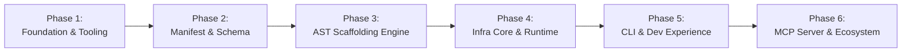

# Vibe Skill: Master Engineering Roadmap

## Overview

Vibe Skill is an open-source, full-stack agent skills registry and Abstract Syntax Tree (AST) scaffolding engine. It bridges high-level AI agent capabilities with deterministic, production-grade code manipulation.

This master roadmap outlines the 6 engineering phases designed to take Vibe Skill from initial workspace scaffolding to an enterprise-grade agent skills ecosystem.

---

---

## Phase 1: Foundation & Monorepo Tooling

**Status:** In Progress / Completed  
**Focus:** Monorepo architecture, workspace management, build pipelines, and developer standards.

### Objectives

- Establish an ultra-fast monorepo environment with **pnpm** and **Turborepo**.
- Standardize TypeScript configurations (`packages/tsconfig/base.json`) with strict typing (`ES2022`, `NodeNext`).
- Set up root orchestration scripts for `build`, `dev`, `lint`, `test`, and `format`.
- Establish automated GitHub Actions CI pipelines for pull requests and main/develop branches.

### Deliverables

- Root `package.json`, `pnpm-workspace.yaml`, and `turbo.json`.
- Strict compiler baseline in `packages/tsconfig`.
- Initial workspace skeletons for `apps/cli`, `apps/mcp-server`, `packages/manifest`, `packages/ast-engine`, and `packages/infra-core`.
- Automated CI pipeline in `.github/workflows/ci.yml`.

---

## Phase 2: Manifest & Specification Standard

**Status:** Planned  
**Focus:** Declarative skill specification, validation schemas, and metadata protocols.

### Objectives

- Define the formal schema for Vibe Skill skill definitions (`skill.yaml` and `skill.json`).
- Implement declarative validation with Zod / JSON Schema in `@vibe-skill/manifest`.
- Support granular capability definitions (tools, prompts, codemods, execution permissions).
- Establish semantic versioning and compatibility matrices for agent runtimes.

### Deliverables

- `@vibe-skill/manifest` package with parser, validator, and schema generator.
- Comprehensive JSON schemas and TypeScript typings.
- Unit and property-based test suites verifying schema compliance.
- Technical specification documentation in `docs/specs/001-manifest-schema.md`.

---

## Phase 3: AST Scaffolding Engine

**Status:** Planned  
**Focus:** Deterministic AST analysis, codemod execution, and structural code injection.

### Objectives

- Develop an AST engine capable of parsing, transforming, and formatting multi-language codebases (TypeScript, JavaScript, Python, Go, Rust).
- Build semantic codemod builders that safely insert imports, inject middleware, scaffold routes, and mutate configuration files without destroying existing formatting.
- Implement AST dry-run diffing and rollback mechanisms to ensure non-destructive agent edits.
- Expose high-level scaffolding primitives for agent consumption.

### Deliverables

- `@vibe-skill/ast-engine` core library with transform pipelines.
- Language-specific parser adapters (TypeScript/Babel, Python libcst).
- Diff generator and AST snapshot testing framework.
- Formal AST Scaffolding Engine specification in `docs/specs/002-ast-scaffolding-engine.md`.

---

## Phase 4: Core Infrastructure & Registry Runtime

**Status:** Planned  
**Focus:** Remote registry communication, package resolution, caching, and sandboxed execution.

### Objectives

- Implement the client layer for publishing, discovering, and downloading skills from the Vibe Skill Registry.
- Build local caching mechanisms with cryptographic integrity verification (SHA-256).
- Create a safe runtime execution environment for running skill-defined pre-install and post-install hooks.
- Provide unified workspace configuration management (`.vibe-skillrc.json`).

### Deliverables

- `@vibe-skill/infra-core` client library.
- Dependency resolution engine handling inter-skill dependencies.
- Sandboxed execution harness with permission enforcement.
- Local cache manager with content-addressable storage.

---

## Phase 5: CLI & Developer Experience (DX)

**Status:** Planned  
**Focus:** Unified command-line interface, interactive terminal UI, and developer workflows.

### Objectives

- Implement the `@vibe-skill/cli` binary (`vibe-skill`).
- Provide core user-facing commands:
  - `vibe-skill init`: Initialize Vibe Skill in an existing repo.
  - `vibe-skill search <query>`: Query available skills from the registry.
  - `vibe-skill add <skill>`: Install skill and execute AST transformations.
  - `vibe-skill create <skill>`: Scaffold a new skill package.
  - `vibe-skill verify`: Validate manifests, AST codemods, and permissions.
  - `vibe-skill publish`: Package and publish a skill to the registry.
- Provide rich terminal feedback (interactive spinners, diff syntax highlighting, error explanations).

### Deliverables

- Standalone CLI executable distributed via npm/pnpm.
- End-to-end integration test suite for CLI commands.
- Interactive terminal UI components.
- CLI user guide and reference manual.

---

## Phase 6: Model Context Protocol (MCP) Server & Ecosystem Integration

**Status:** Planned  
**Focus:** Native AI agent interoperability, Model Context Protocol integration, and registry deployment.

### Objectives

- Implement `@vibe-skill/mcp-server` compliant with the standard Model Context Protocol.
- Expose Vibe Skill skills, AST engines, and registry lookup as MCP tools, prompts, and resources.
- Enable zero-friction integration with agent platforms (Claude Desktop, Cursor, Claude Code, Windsurf, Gemini Code Assist, OpenAI agents).
- Deploy public registry services and documentation hub.

### Deliverables

- Production-ready MCP server executable with stdio and SSE transport support.
- Pre-built integration templates for major agent environments.
- Public registry deployment and community skill marketplace.
- Comprehensive end-to-end tutorials and developer onboarding documentation.
